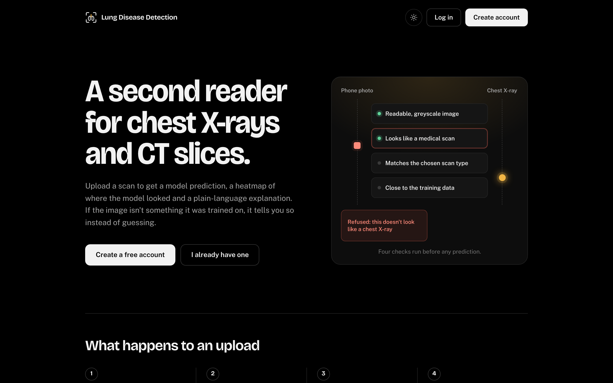
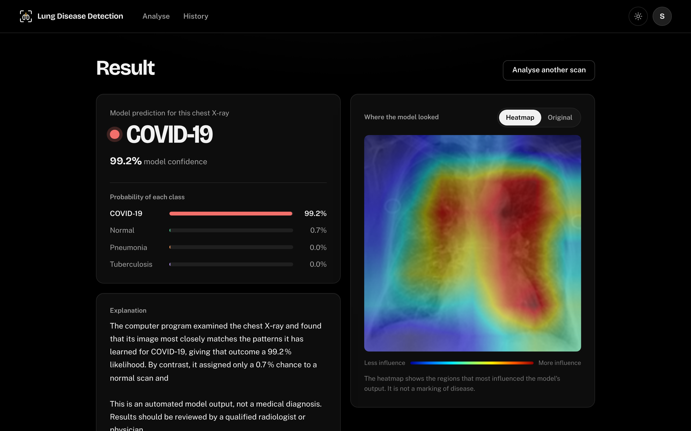
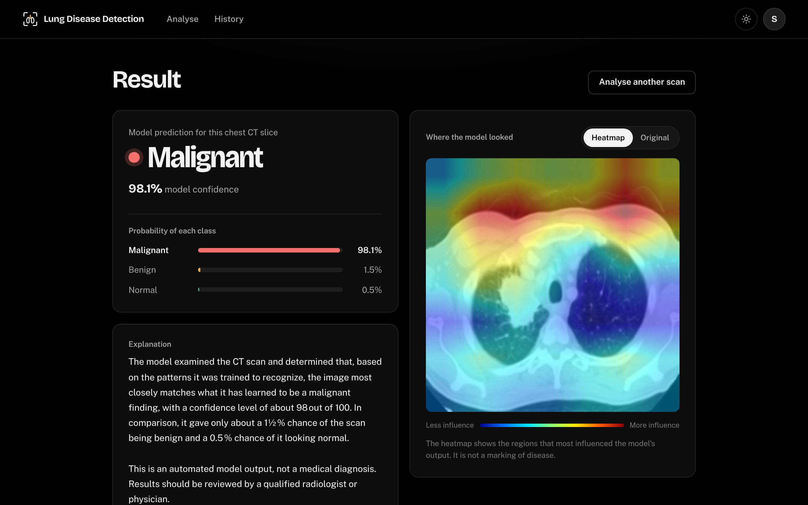
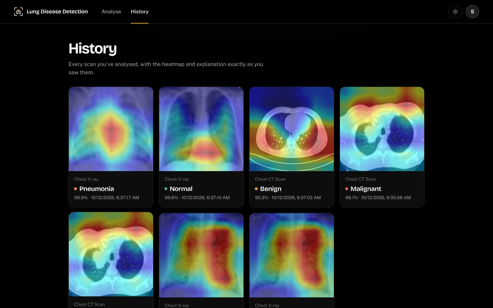
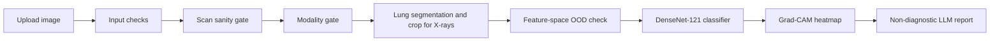
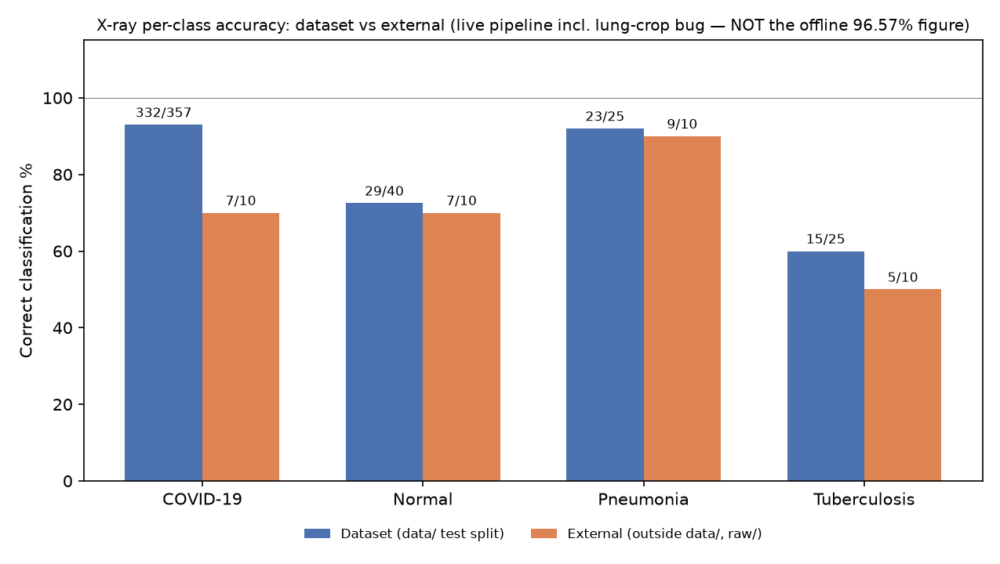
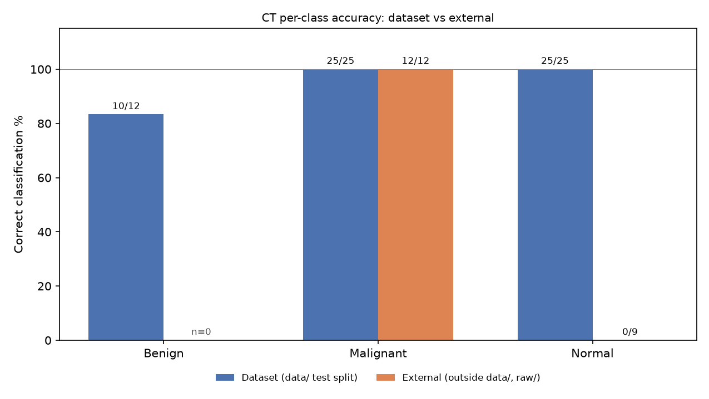

# AI-Powered Lung Disease Detection System

An academic Senior Design Project that analyses chest X-rays and single chest CT slices through a FastAPI and React web application. The system classifies X-rays as COVID-19, Normal, Pneumonia, or Tuberculosis and CT slices as Benign, Malignant, or Normal. It combines transfer-learned DenseNet-121 classifiers with input validation, scan and modality gates, X-ray lung segmentation, feature-space out-of-distribution checks, Grad-CAM explanations, and a non-diagnostic language-model report. This is a research prototype built to explore practical model evaluation and safe presentation of results.

> **Clinical disclaimer:** This is an academic project, not a medical device. It must not be used for diagnosis, treatment, or clinical decision-making.

## Screenshots

| Landing page | Analysis flow |
| --- | --- |
|  |  |

| CT result | Scan history |
| --- | --- |
|  |  |

## Demo

The full walkthrough is in [`screenshots/`](screenshots/): sign-in, upload and analysis, X-ray and CT results with Grad-CAM, the report chat assistant, rejection of an invalid scan, and scan history.

## Architecture



Rejected files receive a clear reason before the disease classifier runs. Accepted X-rays use a chest-X-ray-pretrained TorchXRayVision DenseNet-121; CT slices use a DenseNet-121 fine-tuned from ImageNet weights.

## Results

| Route | Evaluation set | Accuracy |
| --- | --- | ---: |
| Chest X-ray | Held-out test split through the live API | **91.1%** |
| Chest CT | Held-out test split | **98.1%** |

These figures are useful only in the context of the data used to build and evaluate the project. See the generalisation findings below before interpreting them.

## Generalisation

The project deliberately evaluates behaviour outside its training sources. Accuracy drops sharply on images from other hospitals and internet sources: X-ray balanced accuracy falls from about **90% to 33%**, and the CT model obtains **0% accuracy on Normal slices from other hospitals**. The principal cause is dataset and source shortcut learning: the models can learn acquisition style, source markers, and class-correlated preprocessing instead of pathology alone.





The planned remedy is multi-source, patient-level training and evaluation, together with consistent preprocessing, source-resistant augmentation, larger external test sets, calibrated confidence, and stronger open-set rejection. Until then, the CT route is a proof of concept and neither route is suitable for clinical use.

## Tech stack

- **Models:** PyTorch, TorchXRayVision, DenseNet-121, ResNet-18, U-Net, Grad-CAM
- **Backend:** FastAPI, Pydantic, SQLite, bcrypt, JWT, slowapi
- **Frontend:** React, Vite, React Router
- **Evaluation:** scikit-learn, OpenCV, SciPy, ImageHash, pytest
- **Optional integrations:** Groq, Google OAuth, Gmail SMTP

## Setup

### 1. Download model weights

Model weights and prepared datasets are intentionally excluded from Git because they are large and may contain source material that should not be redistributed. Download the published checkpoint bundle from this repository's **GitHub Releases** and extract it into `checkpoints/`. The required files are:

```text
xray_txrv_densenet121_best.pt
ct_best_model_phase35_v2.pt
modality_gate_best_model_v2.pt
xray_sanity_best.pt
ct_sanity_best.pt
xray_seg_model.pt
```

For an academic demonstration, a Google Drive download can also host the same checkpoint bundle. Do not commit `.pt`, `.pth`, datasets, or patient/source images to this repository.

### 2. Configure the backend

```bash
cp backend/.env.example backend/.env
python3 -m venv backend/.venv
backend/.venv/bin/pip install -r requirements.txt
```

Set the required values in `backend/.env`. Groq, Google OAuth, and Gmail are optional: the application uses safe fallbacks where applicable.

### 3. Run locally

In one terminal:

```bash
cd backend
source .venv/bin/activate
uvicorn main:app --reload --port 8000
```

In a second terminal:

```bash
cd frontend
npm install
npm run dev
```

Open the URL printed by Vite, normally `http://localhost:5173`.

### 4. Run tests

```bash
cd backend
source .venv/bin/activate
python -m pytest
```

The tests use a throwaway test database and mock external email and LLM calls. They load real checkpoints and validation data, so a CPU-only run can take several minutes.

## Datasets & credits

All training and evaluation data comes from public datasets. **No source images are redistributed in this repository.** Download them from the original publishers and follow their licences and terms; [data/README.md](data/README.md) documents the cleaning, deduplication and split process.

**Training and internal test sets**

- [COVID-19 Radiography Database](https://www.kaggle.com/datasets/tawsifurrahman/covid19-radiography-database) (Rahman et al.): COVID-19, Normal and Viral Pneumonia X-rays and lung masks
- [Tuberculosis (TB) Chest X-ray Database](https://www.kaggle.com/datasets/tawsifurrahman/tuberculosis-tb-chest-xray-dataset) (Rahman et al.): Normal and Tuberculosis X-rays
- [IQ-OTH/NCCD Lung Cancer Dataset](https://www.kaggle.com/datasets/hamdallak/the-iqothnccd-lung-cancer-dataset): Normal, Benign and Malignant CT slices

**External generalisation tests**

- [Chest X-ray (Pneumonia, COVID-19, Tuberculosis)](https://www.kaggle.com/datasets/jtiptj/chest-xray-pneumoniacovid19tuberculosis): X-rays from a different source
- [Chest CT-Scan Images](https://www.kaggle.com/datasets/mohamedhanyyy/chest-ctscan-images) (derived from [LIDC-IDRI](https://www.cancerimagingarchive.net/collection/lidc-idri/)) and the [Large COVID-19 CT Slice Dataset](https://www.kaggle.com/datasets/maedemaftouni/large-covid19-ct-slice-dataset) (Maftouni et al., used for its Normal slices)
- [SPIE-AAPM-NCI LUNGx Challenge](https://www.cancerimagingarchive.net/collection/spie-aapm-lung-ct-challenge/) (The Cancer Imaging Archive): CT volumes from different institutions and scanners

The X-ray classifier starts from [TorchXRayVision](https://github.com/mlmed/torchxrayvision) DenseNet-121 pretrained weights.

## Project team

- Sharan Pachapuri
- Sampad Gaonkar
- Vijet Nayak

**Guide:** Prof. Indira Bidari  
**Institution:** KLE Technological University, Hubballi  
**Course:** Senior Design Project, 7th Semester Computer Science and Engineering

## License

This project is available under the [MIT License](LICENSE). The license covers the source code only; model weights, datasets, and third-party medical images remain subject to their respective licences and terms.
